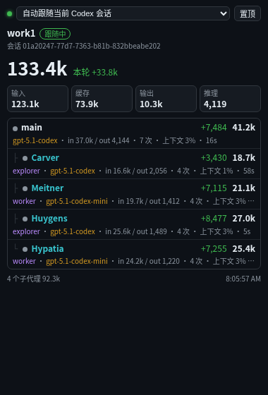

# Codex Token Meter

实时查看 Codex 主 agent 和每个子 agent 的 token 用量和费用估算：输入、缓存输入、输出、推理 token、所用模型、每次请求增量和趋势。提供四种界面：

- **悬浮小窗**：约 360×480 的小页面，可置顶浮在 Codex 桌面版 / IDE / 终端上方，**自动跟随你正在使用的 Codex 会话**。
- **Codex CLI 状态栏**：直接显示在 Codex 终端底部，跟随当前线程（Codex 0.171+ 实验功能）。
- **终端 TUI**：在另一个终端里运行，按 agent 树实时刷新。
- **网页仪表盘**：`http://127.0.0.1:4399`，通过 SSE 实时推送。



不需要 API key，也不依赖第三方 npm 包（Node >= 18）。

## 原理

Codex 会把每个线程（包括每个子 agent）写入 `$CODEX_HOME/sessions/YYYY/MM/DD/rollout-*.jsonl`（默认 `~/.codex`）。Token Meter 持续 tail 这些文件：

| 数据 | 来源 |
| --- | --- |
| 父子关系、昵称、角色 | `session_meta.source.subagent.thread_spawn` |
| 模型、推理强度 | `turn_context.model` / `effort` |
| token 用量 | `token_usage_record`（新版），否则 `event_msg.token_count` |
| 状态 | `task_started` / `task_complete` / `turn_aborted` |

fork 出的子 agent 会继承父线程历史，继承部分（`subagent_history_start_ordinal` 之前的记录）不计入子 agent。

## 费用估算

每个 agent、每个模型、每个会话和全部会话都会显示一个**预估费用（USD）**，出现在 TUI 的「费用」列、网页仪表盘和悬浮小窗、CLI 的 `summary` / `json` 输出，以及 MCP `token_usage` 工具和 Codex CLI 状态栏里。

### 怎么算的

按 OpenAI API 官方定价（美元 / 每百万 token）换算，定价日期 **2026-11-22**，来源：<https://platform.openai.com/docs/pricing>。

| 模型 | 输入 | 缓存输入 | 输出 |
| --- | --- | --- | --- |
| gpt-5 / gpt-5-codex / gpt-5.1 / gpt-5.1-codex / gpt-5.1-codex-max | $1.25 | $0.125 | $10 |
| gpt-5-mini / gpt-5.1-codex-mini | $0.25 | $0.025 | $2 |
| gpt-5-nano | $0.05 | $0.005 | $0.40 |
| gpt-5.2-codex / gpt-5.3-codex | $1.75 | $0.175 | $14 |
| gpt-5.4 / gpt-5.4-mini / gpt-5.4-nano | $2.50 / $0.75 / $0.20 | $0.25 / $0.075 / $0.02 | $15 / $4.50 / $1.25 |
| gpt-5.5 | $5 | $0.50 | $30 |
| gpt-5.6-sol（促销价，至少到 2026-11-30）/ gpt-5.6-terra / gpt-5.6-luna | $4 / $2 / $0.20 | $0.40 / $0.20 / $0.02 | $20 / $12 / $1.20 |
| gpt-4.1 / gpt-4.1-mini / gpt-4.1-nano | $2 / $0.40 / $0.10 | $0.50 / $0.10 / $0.025 | $8 / $1.60 / $0.40 |
| gpt-6.1-sol / gpt-6.2-sol / gpt-6-astra / gpt-6.2-astra | $2 / $2 / $10 / $8 | $0.10 / $0.10 / $1 / $0.40 | $10 / $10 / $50 / $40 |

计费规则（都在 `plugins/codex-token-meter/src/pricing.js` 里，有注释）：

- **缓存输入按缓存价算，未缓存的输入按输入价算**：`input_tokens` 已包含缓存 token，所以未缓存输入 = 输入 − 缓存。
- **推理 token 按输出价算，不另收费**：`output_tokens` 已包含推理 token。
- **写入缓存的 token 不重复收费**：`cache_write_input_tokens` 已包含在 `input_tokens` 里，按输入价包含在输入那一项中，不再单独计费（rollout 里没有缓存有效期，无法按 OpenAI 的缓存写入价单独计费）。
- **未知模型不显示费用，绝不显示 $0**：定价表里没有的模型会显示 `—`，部分模型未定价的合计会带 `~` 前缀（如 `~$0.12`），表示这只是已定价部分的合计。

### 这只是估算，不是账单

- 定价会变，模型会退役：内置定价表是 2026-11-22 的快照，实际账单以 OpenAI 为准。Codex 订阅（ChatGPT / Codex 订阅价）和 API 按量价是两回事，这里按 API 定价估算。
- 不含批量（Batch）折扣、区域附加费、工具调用等其他费用。

### 自定义定价

内置定价过时或模型不在表里时，可以覆盖，优先级：`--pricing-file` > `CODEX_TOKEN_METER_PRICING` 环境变量 > 内置定价。

```bash
# pricing.json：模型 -> { 输入, 缓存输入, 输出 }（美元 / 每百万 token）
# { "gpt-5": { "input": 1.25, "cached": 0.125, "output": 10 },
#   "my-model": { "input": 1, "cached": 0.1, "output": 5 } }
codex-token-meter summary --pricing-file ./pricing.json
CODEX_TOKEN_METER_PRICING='{"gpt-5":{"input":1.25,"cached":0.125,"output":10}}' codex-token-meter web
```

没提到的模型沿用内置定价；格式写错会直接报错，不会悄悄用旧价格。

## 快速开始

```bash
git clone <this repo> && cd codex-token-meter

node plugins/codex-token-meter/bin/codex-token-meter.js          # 终端 TUI
node plugins/codex-token-meter/bin/codex-token-meter.js web --open  # 网页仪表盘
node plugins/codex-token-meter/bin/codex-token-meter.js both     # 同时启动两者
```

也可以 `npm link` 后直接使用 `codex-token-meter`。

| 命令 | 作用 |
| --- | --- |
| `tui`（默认） | 终端界面。`q` 退出，`a` 切换“只看活跃 / 全部会话” |
| `web` | 网页仪表盘（`/api/state`、`/api/events` SSE、`/api/health`） |
| `both` | TUI + 网页 |
| `summary` | 打印一次文字摘要 |
| `json` | 打印完整 JSON 快照 |
| `mini` | 打开悬浮小窗（Chrome/Edge 无边框小窗口，地址 `http://127.0.0.1:4399/mini`） |
| `ensure-web` | 若网页服务未运行，则在后台启动（供 hook 使用）；`--focus` 时从 stdin 读取 hook 输入并切换悬浮窗跟随的会话 |
| `mcp` | stdio MCP 服务：Codex 状态栏 + `token_usage` 工具（插件自动启动） |

选项：`--codex-home <dir>`、`--port <n>`（默认 4399）、`--host <addr>`（默认 127.0.0.1）、`--since <小时>`（默认 24）、`--open`、`--all`、`--pricing-file <文件>`（自定义定价，见「费用估算」）。

## 作为 Codex 插件安装

```bash
codex plugin marketplace add /path/to/codex-token-meter   # 或 Git 地址
codex plugin add codex-token-meter@codex-token-meter
```

插件提供：

- **SessionStart / UserPromptSubmit hook**：启动 Codex 时自动在后台运行仪表盘；每次你在某个会话里发消息，都会把该会话设为悬浮窗的“当前会话”。Codex 要求首次审核插件 hook；在交互式 Codex 启动时的 hook 审核界面里信任它即可（`codex exec` 下未信任的 hook 不会运行）。
- **MCP 服务 `token-meter`**：提供 Codex CLI 状态栏和 `token_usage` 工具（模型可直接查询当前会话的 token）。
- **`token-meter` skill**：在 Codex 里问“子 agent 用了多少 token”时，Codex 会调用 `summary` / `json` 回答并给出仪表盘地址。

### 悬浮小窗

```bash
node plugins/codex-token-meter/bin/codex-token-meter.js mini
```

或在网页仪表盘右上角点“悬浮窗”，或直接打开 `http://127.0.0.1:4399/mini`。

- 下拉框默认“自动跟随当前 Codex 会话”：在哪个 Codex 窗口/会话里发消息，小窗就切到哪个会话；也可以选中某个会话固定显示。
- 点“置顶”会弹出画中画窗口（Document Picture-in-Picture，Chrome / Edge 116+），始终浮在 Codex 等其他窗口上方，可拖动、缩放；关闭画中画后回到普通页面。

Codex 桌面版和 IDE 扩展目前没有给插件开放嵌入自定义页面的接口，所以用置顶悬浮窗代替嵌入。

### Codex CLI 状态栏

在 `~/.codex/config.toml` 中开启实验功能并选择本插件作为状态栏：

```toml
features.tui_extensions_statusline = true

[tui]
status_line_provider = { server = "token-meter", tool = "token_usage" }
```

重启 Codex 后底部会显示：当前线程的 total、输入（缓存）、输出（推理）、费用估算、最近一次请求增量、模型，以及子代理数量、子代理合计和会话合计，每秒刷新，切换线程时自动跟随。也可以在 Codex 里用 `/statusline` 选择。

## 开发

```bash
npm test                 # node:test，含真实 Codex rollout 作为 fixture
npm run mock             # 本地 mock Responses API（:18080），用于无 key 生成父子 agent 会话
```

mock 用法：在 `$CODEX_HOME/config.toml` 中配置 `model_provider = "mock"`，`base_url = "http://127.0.0.1:18080/v1"`，然后 `codex exec "SPAWN_TEST"` 会生成一个主 agent 和两个子 agent（explorer / worker），子 agent 会多轮请求，便于观察实时变化。`MOCK_CHILD_DELAY_MS`、`MOCK_CHILD_STEPS` 可调节节奏。

## 限制

- 费用是按 OpenAI API 定价的估算，不是账单；定价以 <https://platform.openai.com/docs/pricing> 为准，内置定价表见「费用估算」。
- 只读取本机 rollout 文件；网页服务默认只监听 127.0.0.1。
